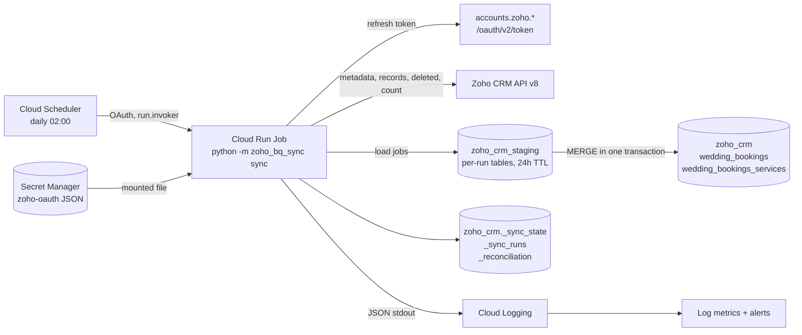

# zoho-bq-sync

Zoho CRM (REST API v8) to Google BigQuery replication for a demo business: an agency that
organizes international weddings and civil marriages. Zoho CRM is the operational system.
BigQuery is the analytical warehouse.

The demo runs against a **Zoho developer org with synthetic records** (every booking name
starts with `WB-SYN-`). Unit tests use clearly labelled mocks. Nothing has been deployed yet.
`deploy/` holds the scripts that do it.

## What it does

| Capability | How |
|---|---|
| OAuth 2.0 | Refresh-token grant, the 1 h access token is cached and refreshed 5 min before expiry. Re-auth happens once on `INVALID_TOKEN`. A guard stops refresh storms (Zoho allows 10 tokens per 10 min). |
| Data centers | `ZOHO_DC` = us, eu, in, au, jp, cn, ca, sa, us-developer or us-sandbox, plus explicit URL overrides |
| Discovery | `GET /settings/modules` and `GET /settings/fields?module=` cover standard, custom and subform modules |
| Dynamic schema | Zoho `data_type` is mapped to a BigQuery type. New fields arrive as `ADD COLUMN` (NULLABLE). Safe widening uses `ALTER COLUMN SET DATA TYPE`. Nothing is ever dropped. |
| Subforms | Each subform goes to its own child table with a `parent_id` FK. Rows removed in Zoho are soft-deleted when the parent is re-synced. |
| Incremental | `If-Modified-Since` + `sort_by=Modified_Time`. The persistent checkpoint is drift-safe and has a configurable overlap. |
| Deletions | `GET /{module}/deleted?type=all` handles incremental deletes. A full resync soft-deletes rows missing upstream and has a mass-delete guard. |
| Idempotent writes | Load job into a staging table, then versioned `MERGE` statements and the checkpoint update in **one BigQuery transaction** |
| Rate limits | Exponential backoff with jitter, `Retry-After`, a 429-aware client, `X-API-CREDITS-REMAINING` tracking and a per-run API-call budget |
| Observability | JSON logs for Cloud Logging, `_sync_runs`, `_sync_state` and `_reconciliation` tables, a freshness command and log-based metrics |

## Architecture



More diagrams and the design rationale are in [docs/architecture.md](docs/architecture.md).

## Repository layout

```
src/zoho_bq_sync/
  config.py            env configuration, data centers
  secrets.py           env / mounted file / Secret Manager resolution
  logging_setup.py     JSON (Cloud Logging) and text formatters, run context
  zoho/
    auth.py            OAuth refresh-token flow
    client.py          HTTP client: retries, backoff, re-auth, budget, credits
    metadata.py        module and field discovery
    records.py         list (page/page_token), by ids, single record, deleted, count
  schema/
    type_mapping.py    Zoho data_type -> BigQuery type
    naming.py          identifier normalization and collision handling
    builder.py         parent and child TableSpecs from metadata
    evolution.py       additive schema diff (create / add / widen / conflict)
  transform/
    coerce.py          value coercion (NUMERIC as decimal string, UTC timestamps)
    normalize.py       record -> parent row, subform -> child rows
  warehouse/
    sql.py             MERGE / UPDATE / transaction SQL generation
    bigquery.py        staging, transaction, DDL, reconciliation queries
    ops.py             operational table schemas
  sync/
    extract.py         extraction strategy per module
    checkpoint.py      drift-safe checkpoint
    engine.py          orchestration
    reconcile.py       row-count checks
  demo/synthetic.py    deterministic synthetic bookings
scripts/               OAuth bootstrap, seeding and mutation of demo data
sql/demo, sql/monitoring
deploy/                GCP setup, Cloud Run Job, Scheduler, monitoring
tests/unit             mocked, fast
tests/integration      live Zoho / BigQuery, opt-in
docs/                  architecture, Zoho API notes, setup, deployment, demo, Q&A
```

## Quick start (local)

```bash
python3.11 -m venv .venv && source .venv/bin/activate
pip install -r requirements-dev.txt && pip install -e .
python -m pytest tests -q          # unit tests, no network
cp .env.example .env               # then fill it in (GCP_PROJECT has no default)
# this repo's own gcloud config and ADC, separate from other GCP work: docs/demo_walkthrough.md, step 5
CLOUDSDK_CONFIG=$HOME/.config/gcloud-zoho-bq-sync gcloud auth application-default login
set -a; source .env; set +a
python -m zoho_bq_sync discover --modules Wedding_Bookings
python -m zoho_bq_sync sync --summary
```

1. Zoho org and module setup: [docs/zoho_setup.md](docs/zoho_setup.md).
2. GCP deployment: [docs/deployment.md](docs/deployment.md).
3. 15-minute demo script: [docs/demo_walkthrough.md](docs/demo_walkthrough.md).

## Commands

| Command | Purpose |
|---|---|
| `sync` | Incremental by default. The first run is a full load. |
| `sync --full` | Manual full resync: re-reads everything and soft-deletes rows missing in Zoho |
| `sync --since 2026-11-01T00:00:00Z [--until ...]` | Replays a window. The checkpoint is not moved. |
| `sync --dry-run` | Extracts and plans only, writes nothing to BigQuery |
| `discover [--compare-bigquery]` | Shows the generated schema and marks columns that would be added |
| `reconcile` | Compares the Zoho record count with active BigQuery rows (read-only) |
| `freshness --max-age-hours 26` | Exits with code 2 if a module has no recent successful sync |

## Tests

```bash
python -m pytest tests -q                                   # unit (default, mocked)
RUN_LIVE_TESTS=1 python -m pytest -m integration tests/integration/test_live_zoho.py
RUN_LIVE_TESTS=1 BQ_TEST_PROJECT=<project> python -m pytest -m integration tests/integration/test_live_bigquery.py
```

The unit tests cover OAuth refresh, pagination (`page` and `page_token`), field chunking, retry and
backoff, field discovery, type mapping, schema evolution, subform normalization, MERGE SQL,
drift-safe checkpoints, the BigQuery adapter (mocked client) and end-to-end orchestration.
The orchestration tests use an in-memory warehouse that models the SQL semantics.
The live BigQuery test runs the generated SQL against a temporary dataset.

## Status and honest limitations

- Verified here: 133 unit tests pass on Python 3.11.
- Not yet verified: the live integration tests, the Docker build and the GCP deployment.
  Run them in your project first, following [docs/demo_walkthrough.md](docs/demo_walkthrough.md).
- Zoho API behaviour that cannot be proven from the docs (e.g. whether an edit to a subform row
  alone bumps the parent `Modified_Time`) is flagged in [docs/zoho_api_notes.md](docs/zoho_api_notes.md).
  The demo checks it live.
