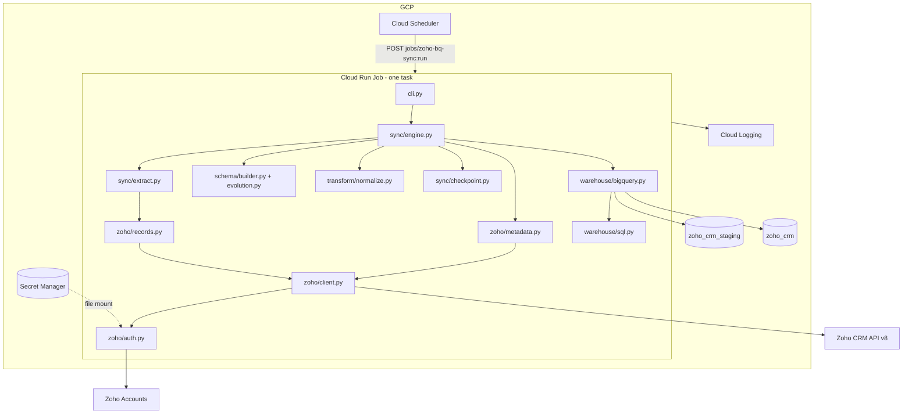
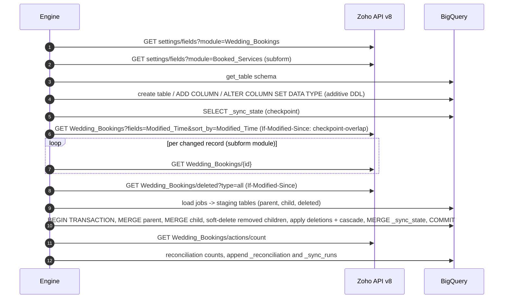
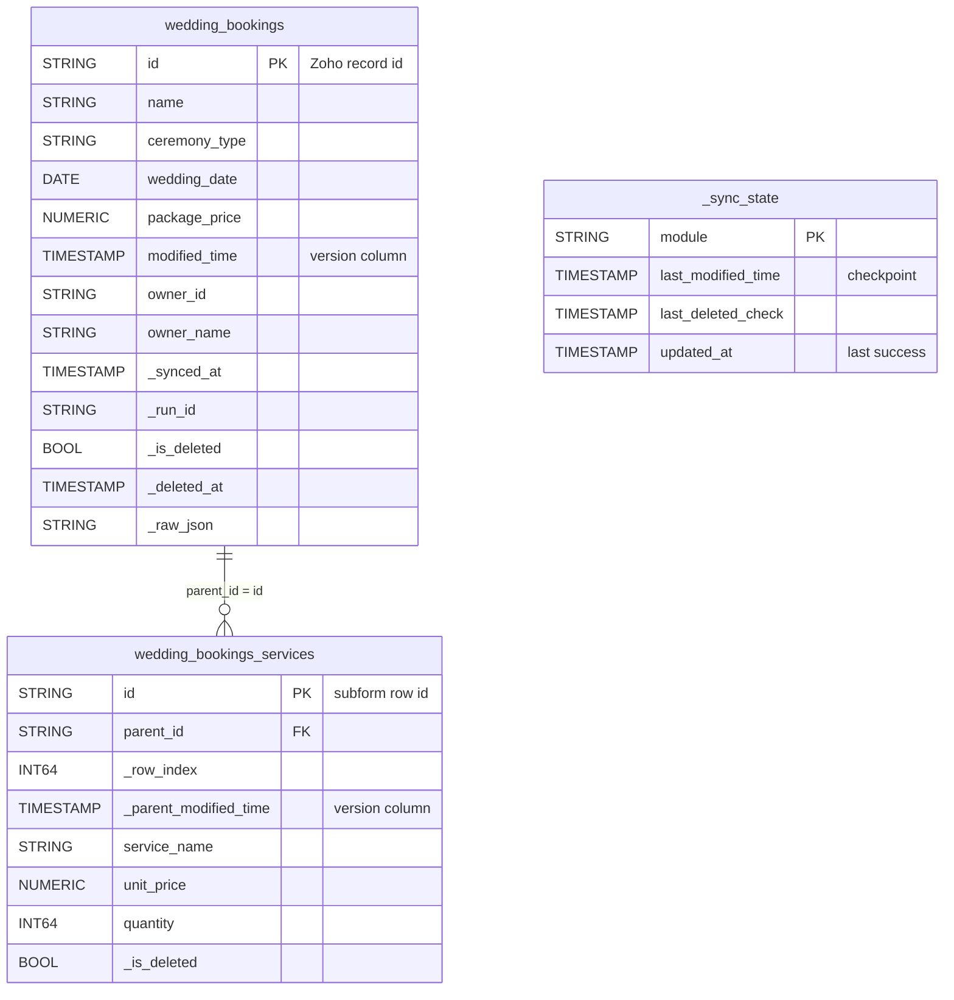

# Architecture

## Components

## One module, one run

## Data model

## Key design decisions

1. **The checkpoint commits in the same transaction as the data.** The pipeline cannot reach a
   state where the data was written but the checkpoint was not, or the reverse. A crash at any
   point means the next run re-reads the same window. MERGE is idempotent, so that is safe.
2. **Versioned MERGE.** The rule is `WHEN MATCHED AND S.modified_time >= T.modified_time`, so a
   replay or an overlapping window never overwrites newer data with older data. The same version
   may re-write a row, which is how new columns get backfilled, with one exception: a row
   soft-deleted after that source row was read stays deleted. Removed subform rows are stamped
   with the parent's new version for the same reason.
3. **Load jobs, not streaming inserts.** Rows in the streaming buffer cannot be updated by DML.
   Load jobs are free, atomic and schema-checked.
4. **Additive-only schema evolution, outside the transaction.** BigQuery does not allow DDL inside
   multi-statement transactions. Adding a NULLABLE column is harmless if the data step later fails.
   Type conflicts fail before any write.
5. **Soft deletes.** `_is_deleted` and `_deleted_at` keep history and make deletions auditable.
   Analysts filter with `_is_deleted IS NOT TRUE`. Hard purge, if required, is a separate job.
6. **Drift-safe checkpoint** ([sync/checkpoint.py](../src/zoho_bq_sync/sync/checkpoint.py)).
   Offset pagination over a live, time-sorted result set can skip a record that is edited during
   the run. The checkpoint only advances over pages served before the first concurrent edit.
7. **Module isolation.** Each module has its own transaction. One failing module does not block
   the others, but the run still exits non-zero, so the Cloud Run execution is marked failed.
8. **Explicit budget.** Zoho API credits are shared by the whole org for 24 hours. A runaway sync
   must not take down other integrations, so each run has a hard call cap.
9. **Warehouse interface.** The engine depends on a small protocol. BigQuery SQL is tested as
   strings and executed in the live test. Orchestration is tested against an in-memory model.

## Type mapping

| Zoho data_type | BigQuery | Notes |
|---|---|---|
| text, textarea, email, phone, website, picklist, autonumber | STRING | |
| integer, bigint | INT64 | |
| double, percent | FLOAT64 | |
| currency, decimal | NUMERIC | Loaded as a decimal string: no float rounding |
| boolean | BOOL | |
| date | DATE | |
| datetime | TIMESTAMP | Converted to UTC |
| lookup, ownerlookup, userlookup | `<f>_id` STRING + `<f>_name` STRING | |
| multiselectpicklist | REPEATED STRING | `UNNEST()` in queries |
| multiselectlookup, multiuserlookup, fileupload, imageupload, consent_lookup | STRING (JSON text) | `JSON_VALUE()` works on it |
| formula, rollup_summary | from `return_type` | |
| subform | child table | `<parent>_<subform>` or `TABLE_NAME_OVERRIDES` |
| unknown | via `json_type`, else JSON text | Logs `type_mapping_fallback` |

Column names come from the Zoho API name, lowercased, with non-`[a-z0-9_]` characters replaced.
A leading `_` is reserved for pipeline columns. Collisions are resolved deterministically by Zoho
field id order.
